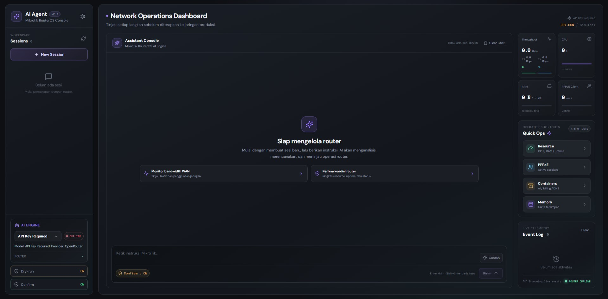

<div align="center">

# 🤖 MikroTik AI Control

**AI agent + web UI to manage MikroTik RouterOS via the REST API.**

[](https://hub.docker.com/r/dhethix/mikrotik-ai-control)


</div>

---

<div align="center">
  
</div>

---

**MikroTik AI Control** is a container-based management platform for MikroTik devices, driven by AI. It brings the power of LLMs directly to your network management interface.

> [!NOTE]  
> **Not** an official MikroTik, OpenRouter, or Groq product. This is a community project — please use at your own risk.

## 📑 Table of Contents
- [✨ Features](#-features)
- [🚀 Quick Start](#-quick-start)
- [🔑 Get an API Key](#-get-an-api-key)
- [⚙️ RouterOS Preparation](#️-routeros-preparation)
- [🐳 Deployment Options](#-deployment-options)
  - [Docker Compose](#docker-compose)
  - [RouterOS Container Host](#routeros-container-host)
- [🛠️ Environment Variables](#️-environment-variables)
- [🏷️ Docker Tags](#️-docker-tags)

---

## ✨ Features

- 🌐 **Web Dashboard** — Interactive chat, session history, and live metrics.
- 🤖 **AI Providers** — Supports **OpenRouter** and **Groq** (including free-tier capable models) seamlessly.
- 🌍 **Bilingual Support** — UI toggle for **English** and **Indonesian** (AI replies follow UI language).
- 🛡️ **Safety First** — Dry-run & Confirm modes (default **ON**) to prevent accidental network changes.
- 🛠️ **Extensive Router Tools** — Manage resources, interfaces, VLAN, DHCP, WireGuard, queues, PPP, firewall helpers, and raw REST.
- 💾 **Persistent Storage** — Session history and settings stored locally in SQLite (`/app/data`).

---

## 🚀 Quick Start

Run the container instantly:

```bash
docker pull dhethix/mikrotik-ai-control:0.2.0

docker run -d --name mikrotik-ai \
  -p 8000:8000 \
  -v mikrotik-ai-data:/app/data \
  dhethix/mikrotik-ai-control:0.2.0
